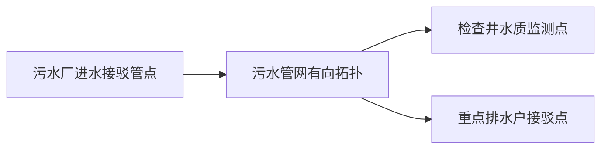
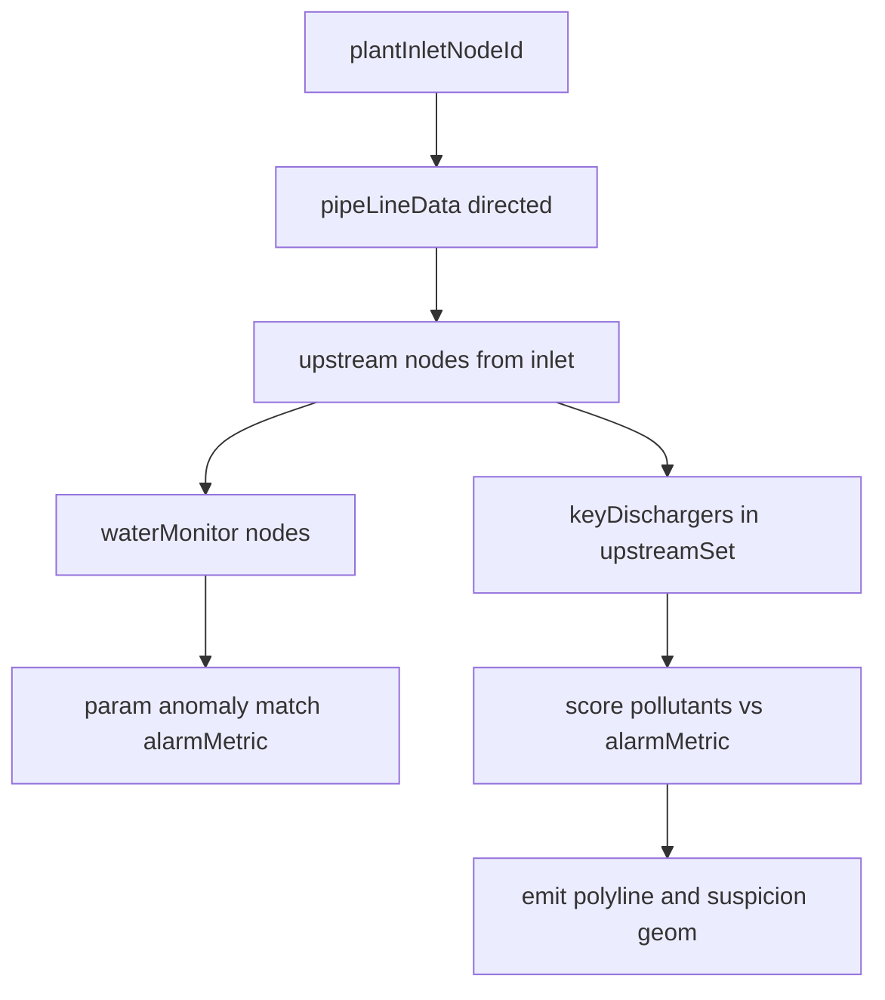

# 水质事件管网溯源分析（原型增强）

## 溯源分析功能梳理（业务视角）

### 功能定位

面向 **污水处理厂进水水质异常类运行事件**，在台账与管网拓扑约束下，给出 **「上游哪里可能有问题」** 的辅助研判：先核对管网在线监测是否与厂进口 **同一告警指标** 吻合，再在上游可达范围内列出 **重点排水户** 并按 **与告警指标的关联强弱** 排序，配合 **溯源地图** 标出 **溯源链路与线下摸排怀疑范围**，便于现场核查。

结论均为 **辅助推断（原型演示）**，正式环境需对接实时监测、拓扑维护与水力模型校验。

### 适用场景与入口

| 场景 | 是否提供溯源 |
|------|----------------|
| 污水厂事件列表 · **水质类**事件（如水质超标；规则可扩展为事件类型含「水质」） | 行内 **联动分析**（名称可并列展示为溯源分析） |
| 非水质类事件（设备故障、停电等） | **不提供**入口 |
| 泵站事件列表 | **不提供**（溯源模型锚定在厂进水与污水管网） |

### 核心业务对象与关系（自上而下）

- **污水厂**：通过演示映射绑定 **进水接驳管点**（厂外管网侧终点）。
- **管网**：管线为有向边（下游指向厂前进水）；部分检查井挂 **水质监测**。
- **排水户**：仅台账 **`keyDischarger === '1'`（重点排水户）** 纳入摸排列表；**接驳点编码 / 接入检查井编码** 与 **管点 `nodeId`** 对齐后方可参与拓扑可达判定。
- **告警指标**：来自事件的 **告警指标** 字段（推荐）或解析说明文字；限定为 COD / NH₃-N / TP / TN 之一，用于「监测吻合」与污染物文本匹配。

### 分析流程（可对运营口述的步骤）

1. **锁定事件与时间窗**：读取事件发生时间与可调分析窗口（默认仍为事件前后若干小时，可与现有联动面板一致）。
2. **确定厂进口告警指标**：明确本次进水报警对应的 **单项水质参数**。
3. **沿污水管网向上游展开**：从厂前进水接驳管点出发，按管线方向 **逆向** 遍历上游管点集合。
4. **监测吻合判定**：在上游路径上的 **水质监测检查井** 中，查找是否存在与告警指标 **同类别的异常**（演示用阈值 + 时序种子）；用于支撑「异常是否来自上游管网」这一判断。
5. **枚举上游重点排水户**：在可达上游集合内筛 **`keyDischarger === '1'`**，读取污染物名称与主要成分等字段。
6. **可能性排序**：按告警指标与 **`grade1Pollutant` / `grade2Pollutant` / `material`** 等文本的匹配规则打分，输出 **高 → 低** 排序清单，供线下优先核查。
7. **地图呈现**：同路径生成 **链路折线**、**怀疑范围面/缓冲带**、**重点户点位**，与列表结论一致。

### 产出物（用户可见）

| 产出 | 说明 |
|------|------|
| 分析摘要 | 事件快照、时间窗、告警指标、免责声明 |
| 管网溯源 | 上游路径步骤（含监测点是否吻合）、**重点排水户排序表**（含匹配依据摘要）；注明 **非重点排水户未纳入本次摸排** |
| 溯源地图 | 链路线 + 怀疑范围 + 重点户标注（示意几何，支持线下路线参考） |
| 辅助信息（可选保留） | 进水过程曲线、设备运行等 **不参与溯源主链路**，可作为并列 Tab 保留便于对照 |

### 功能边界与约束（摘要）

- **只做水质类污水厂事件**；泵站与非水质事件 **不提供入口**。
- **摸排对象仅限重点排水户**；非重点不参与排序（界面文案说明原因）。
- **原型数据**：须补齐连通污水子图、厂前进水节点、接驳点与管点对齐；地图几何由溯源模块输出占位坐标。
- **真实接入**：监测时序、拓扑方向、在线校准以后端为准。

---

## 溯源地图（实现要点回顾）

- **目的**：便于用户 **线下摸排**，在弹窗内增加 **地图区域**（独立 Tab「溯源地图」或与「管网溯源」同页上下分栏）。
- **展示内容（原型示意）**：
  - **链路**：厂进水接驳点 → 上游监测检查井 → … → 接驳点（折线/顺序编号），与列表 Steps 一致；
  - **怀疑范围**：以上游路径为中心线的 **缓冲带状区域** 或 **节点包络多边形**（演示可用固定宽度缓冲或少量坐标围成的浅色半透明面），表示建议线下巡查范围；
  - **重点排水户**：仅对纳入排序的重点户落 **标注点**（与台账 `coordX/coordY` 或管点坐标一致）。
- **实现取向**：现有 [`AddrWgs84DetailMap`](src/prototypes/shared/addrWgs84MapFormBridge.tsx) / `EmergencyEventDetailMap` 偏 **单点**；若不支持折线/面，则新增小型 **只读地图组件**（与应急协同同源地图 SDK），传入路径坐标数组与多边形顶点（占位数据由溯源模块输出）。无需用户交互编辑坐标。

## 现状缺口（需在实现中补齐）

- [`pipe-network-demo-data.ts`](src/prototypes/韶山水环境设施管理系统/pipe-network-demo-data.ts)：当前管线互不连通，且 **未绑定污水厂进水节点**。
- [`facility-discharger-data.ts`](src/prototypes/韶山水环境设施管理系统/facility-discharger-data.ts)：`connManholeId` / `jbdId` 与 `nodeId` 格式需对齐；并保证演示路径上存在 **`keyDischarger === '1'`** 的记录。
- [`facility-event-linked-analysis-data.ts`](src/prototypes/韶山水环境设施管理系统/facility-event-linked-analysis-data.ts) / [`facility-event-linked-analysis.tsx`](src/prototypes/韶山水环境设施管理系统/facility-event-linked-analysis.tsx)：需接入拓扑溯源 + **重点排水户过滤** + **地图几何输出**。

## 数据层改造（演示同源）

1. **管点扩展（可选字段）**  
   - 对若干污水检查井增加：`水质监测点?: boolean` 等。

2. **管线方向（污水子图）**  
   - 有向边 + **厂前进水节点**；维护 `plantId → inletNodeId` 映射表。

3. **排水户对齐管点**  
   - 接驳点编码与管点一致；**优先保证重点排水户**落在可溯源子图上。

4. **告警指标**  
   - 推荐在演示事件中增加 **`告警指标`** 字段（COD / NH3-N / TP / TN）。

## 溯源算法要点

- **上游集合**：从厂进水节点反向遍历污水管线子图。
- **监测吻合**：与告警指标一致的演示峰值判定。
- **排水户枚举与排序**：仅 **`keyDischarger === '1'`**；按污染物文本与告警指标匹配度排序。
- **地图输出**：输出 `pathLngLats`、`suspicionPolygon` 或 `bufferMeta`、`markers`（重点户与关键节点）。

## 界面结构（与「产出物」表对应）

- **Tab 建议顺序**：分析摘要 → 管网溯源 → 溯源地图 →（可选）进水水质 / 设备运行（二者不进主链路，仅对照）。
- **管网溯源**：路径 Steps + 重点排水户排序表 + 非重点未纳入说明。
- **溯源地图**：与管网同源的路径线、怀疑范围面、重点户标注。
- **命名**：行内按钮可仍为「联动分析」，弹窗标题侧可体现「溯源分析」——实施时再统一文案。

## 列表层改动

- [`facility-plant-event-list-view.tsx`](src/prototypes/韶山水环境设施管理系统/facility-plant-event-list-view.tsx)：仅水质类显示「联动分析」。
- [`facility-pump-event-list-view.tsx`](src/prototypes/韶山水环境设施管理系统/facility-pump-event-list-view.tsx)：移除联动分析按钮。

## 文档

- 更新 [`spec.md`](src/prototypes/韶山水环境设施管理系统/spec.md)：水质入口、**重点排水户范围**、地图为原型示意、接驳点与管点一致约定。

## 验收

- 水质事件：可见溯源列表（仅重点户）、排序合理、地图有线与怀疑范围。
- 非水质事件：无联动分析按钮。
- 非重点排水户：不出现于事前排摸列表（有文案说明）。
