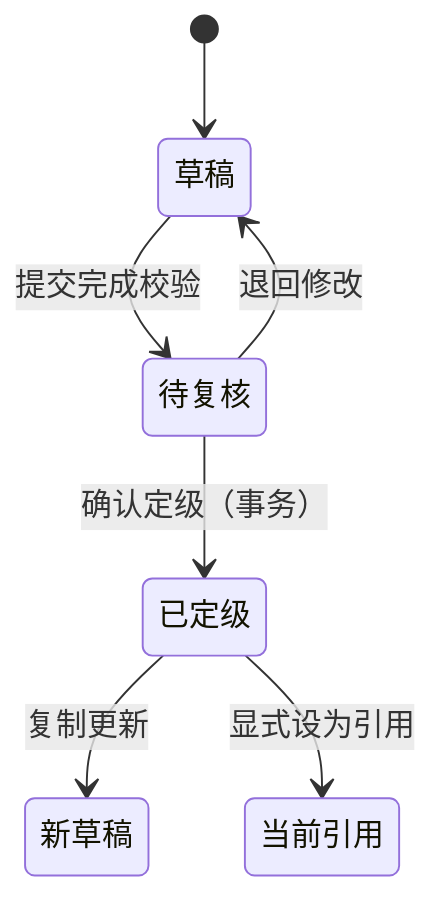
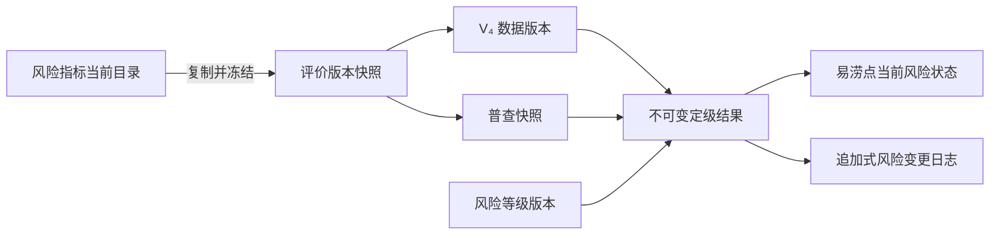

# 风险自动定级前后端及原型完整审查报告

> 文档用途：第三方开发团队整改、产品验收、测试设计和上线评审
>
> 审查日期：2026-07-30
>
> 审查范围：风险指标管理、指标评价版本、风险等级版本、防灾减灾 V₄、内涝普查、风险定级、风险变更日志
>
> 原型仓库：`FloodRisk`，审查提交 `ac68441f7a2e00632864c201da7aaf2860e71764`
>
> 生产前端：`waterlogging-risks-web-dev`，提供目录未包含 `.git`，无法核实提交号；`package.json` 版本为 `1.7.2`
>
> 生产后端：`waterlogging-service`，审查提交 `8ba73448403b2b1ab45f7290816a9f1a0339310c`
>
> 测试环境：`/dq-waterlogging-25/waterlogging-risks-web/flood-risk/*`

---

## 1. 执行结论

### 1.1 上线结论

**当前版本不建议进入正式风险定级生产使用。**

原因不是单一页面缺陷，而是风险定级的四条关键数据链同时存在阻断问题：

1. **前端调用错接口**：普查删除和普查“设为引用”调用了易涝点主数据接口，存在误删、误改易涝点主档的风险。
2. **请求字段被后端静默丢弃**：风险指标 `survey` 配置、附表 B 的高程/下穿深度/汇水面积等字段不在后端 DTO 中，界面即使显示保存成功，服务端也无法完整保存。
3. **历史依据可被覆盖**：已完成、当前引用或已被定级使用的评价版本、等级版本、V₄、普查记录仍可直接编辑或删除，历史结果无法保证复现。
4. **定级过程不具备事务一致性**：保存普查、切换引用、写入定级结果、同步易涝点、写风险日志之间缺少可靠的状态边界、幂等和并发控制。

此外，仓库配置文件存在明文敏感凭据，属于独立的安全阻断项。报告不摘录任何凭据内容；应立即轮换并清理历史。

### 1.2 整改优先级

| 级别 | 定义 | 上线要求 |
|---|---|---|
| P0 | 可能误删主数据、丢字段、改写历史、错误定级、越权或泄露凭据 | 全部修复并通过回归后方可上线 |
| P1 | 会造成流程不一致、结果难以复现、操作误导或较高维护风险 | 原则上随 P0 同期修复 |
| P2 | 体验、可观测性、性能或工程质量问题 | 明确排期和责任人 |

### 1.3 本次审查的验证边界

- 已完成原型、生产前端、生产后端的风险自动定级相关源码静态审查和跨端接口核对。
- 原型专项检查结果：19 个测试文件、125 项测试通过；测试结束时存在 Vite 进程退出超时提示，不影响断言结果，但应单独治理测试资源释放。
- 测试环境未获得业务账号和生产等价数据，未执行删除、引用、定级等破坏性接口调用。
- 生产前端目录缺少 `.git` 和 `node_modules`，且 `package.json` 没有测试脚本，因此无法确认其提交版本，也未对该目录作本地构建结论。
- 后端审查环境没有 Maven，仓库也没有 Maven Wrapper；仓库中未发现 `src/test`，本次后端结论以源码、接口和数据流静态审查为依据。
- 未提供生产数据库 DDL、迁移记录、约束清单和脱敏数据，数据库唯一性、外键、索引及存量数据质量需要在整改阶段补充核验。

---

## 2. 已确认的业务基线

下列规则是本报告判断问题和设计整改方案的统一基准。

### 2.1 风险指标

- 风险指标目录维护指标定义、数据类型、普查填报配置、赋分规则、条件来源和复合指标关系。
- 指标目录变化不能反向改变已发布评价版本的计算语义。
- 指标被评价版本、条件赋分、复合指标、普查或定级结果引用后，不允许直接删除；需要停用或新建版本。
- “条件赋分方式”不是一个独立且有业务价值的人工选择。指标选择条件赋分后，应由系统依据字段类型展示相应条件配置，避免同义配置并存。

### 2.2 评价版本

- 评价版本应冻结完整指标定义快照、启用状态、权重、赋分规则和条件/复合关系。
- 版本状态至少区分：草稿、已完成、当前定级引用。
- 已完成、当前引用或已被业务数据引用的版本不可原地编辑、删除；修改必须复制为新草稿。
- 设为当前定级引用前，必须同时通过权重校验和全部启用指标可计算性校验。

### 2.3 风险等级版本

- 风险等级版本独立于评价版本，并被定级结果精确引用。
- 启用前必须验证区间完整覆盖 `[0,1]`、无重叠、无缺口，且端点包含关系明确。
- 已完成、当前引用或已被定级结果使用的版本不可变。

### 2.4 防灾减灾 V₄

- V₄ 数据记录必须绑定一个明确的评价版本。
- 一个评价版本最多有一个当前 V₄ 数据引用。
- 已完成、当前引用或已被定级结果使用的 V₄ 不可变。
- V₄ 计算不能依赖写死的指标代码集合，应由已冻结的指标元数据驱动。

### 2.5 普查与定级

- 普查草稿允许信息不完整；完成校验和正式定级是两个不同动作。
- 正式定级必须锁定评价版本、等级版本、V₄ 记录和普查原始值快照。
- “初次定级”使用当前显式引用；“更新定级”使用该点历史结果锁定的版本，不能静默切换。
- 未明确设置当前引用时必须阻断，不能回退到第一条或最近一条已完成记录。
- 定级结果、易涝点风险等级和风险变更日志必须在同一事务中提交。

### 2.6 切换评价版本后的普查生成

这是本次审查已明确的业务要求：

1. 切换评价版本后，**重新生成普查批次**。
2. 不修改风险指标目录、权重、赋分规则、条件/复合配置。
3. 不修改既有普查记录中的原始指标填报值。
4. 新普查复制易涝点、必要基础信息和原始填报值，绑定新的评价版本。
5. 新普查清空定级结果和数据引用，状态为待复核/草稿。
6. 原普查、原版本、历史定级结果和风险日志保持不变。
7. 生成操作以“目标评价版本 + 易涝点”为幂等键，重复执行不得生成重复记录。

---

## 3. 问题总览

### 3.1 P0 阻断问题

| 编号 | 模块 | 问题摘要 |
|---|---|---|
| P0-01 | 安全配置 | 后端配置文件提交了明文敏感凭据 |
| P0-02 | 普查接口 | 普查删除、普查引用误调用易涝点主数据接口 |
| P0-03 | 指标接口契约 | 后端新增/编辑 DTO 不接收完整 `survey` 和默认快照 |
| P0-04 | 附表 B 契约 | 多个关键字段及附件未被后端接收，且未知字段被静默忽略 |
| P0-05 | 普查状态机 | 新增/编辑强制完成并试算，无法保存真实草稿 |
| P0-06 | 历史不可变 | 已完成、当前引用、已被使用的版本和普查仍可覆盖或删除 |
| P0-07 | 审计日志 | 风险变更日志暴露新增、编辑、删除接口，不满足不可篡改要求 |
| P0-08 | 定级准入 | 不完整评价/等级/V₄ 可成为当前引用，缺字段仍可能定级成功 |
| P0-09 | 并发与唯一性 | 当前引用切换和版本编号存在竞态，缺少数据库唯一约束证据 |
| P0-10 | 评价快照 | 评价版本未冻结完整指标定义，目录变更可改变历史结果 |
| P0-11 | 版本切换 | 切换评价版本未重新生成普查批次，原型同步逻辑还会改写历史普查 |
| P0-12 | 普查编辑 | 编辑任意普查可能清空当前引用，且新值与旧定级结果并存 |
| P0-13 | 一致性控制 | 乐观锁失败仍可能同步主档并写日志，产生三方数据不一致 |
| P0-14 | 评分正确性 | 等级端点、数值区间、前端试算与后端正式评分语义不一致 |
| P0-15 | 权限 | 风险自动定级写接口缺少明确的角色/权限控制 |

### 3.2 P1 核心问题

| 编号 | 模块 | 问题摘要 |
|---|---|---|
| P1-01 | V₄ 评分 | 后端写死 7 个 V₄ 指标代码，扩展或改名后无法可靠计算 |
| P1-02 | 复制编辑 | 前端直接修改 props、误判返回值，重复点击可能生成多个版本 |
| P1-03 | 删除/取消引用 | 风险等级用清空数组模拟删除，V₄ 取消引用提交不完整对象 |
| P1-04 | 前端校验 | 权重、指标完整性、等级区间的状态展示与真实后端语义不一致 |
| P1-05 | 版本绑定 | 新建普查未提交评价/等级/V₄ 精确引用，可能绑定请求瞬间的活动版本 |
| P1-06 | 引用快照 | 页面分开请求评价与等级，可能拼接出从未共同生效的版本组合 |
| P1-07 | 复制与确认幂等 | 缺少复制来源、幂等键和重复提交保护 |
| P1-08 | 空值语义 | 前端把未采集的附表 B 字段转换成 `0/false`，可导致错误评分 |
| P1-09 | 附件 | 原型要求的 PDF 附件上传、校验、保存和下载链路未实现 |
| P1-10 | 未保存保护 | 多个弹窗缺少脏状态确认，保存失败仍可能关闭或继续执行依赖动作 |
| P1-11 | 指标向导 | 复合指标创建仅显示占位提示，不能完成必要配置 |
| P1-12 | 编码与默认值 | 后端静默改写重复指标编码，初始化状态和前端展示可能不一致 |
| P1-13 | 历史引用 | 风险日志未保存足够的记录 ID、快照哈希和精确版本引用 |
| P1-14 | 定级模式 | 更新定级依据可变的易涝点当前等级判断，而不是历史定级结果 |
| P1-15 | 指标归组 | 前端把 `PR_` 指标错误归入承灾体因子 |
| P1-16 | 评价编辑 | 前端加载评价时伪造指标类型/规则并写死适用点位类型 |
| P1-17 | 审计内容 | 确认备注未落日志，等级颜色可能来自错误的当前版本 |

### 3.3 P2 工程与运行问题

| 编号 | 模块 | 问题摘要 |
|---|---|---|
| P2-01 | 自动化测试 | 生产前端无业务测试脚本，后端无测试目录 |
| P2-02 | 数据库迁移 | 未发现风险自动定级相关可审计 DDL/迁移和约束基线 |
| P2-03 | 废弃状态仓库 | 前端遗留旧 workspace store，仍包含静默回退和全量覆盖逻辑 |
| P2-04 | 参数边界 | 时间字段格式、分页上限、部分字符串 JSON 缺少强校验 |
| P2-05 | 跨域配置 | CORS 允许方法未包含实际使用的 `PUT` |
| P2-06 | 原型运行 | 专项测试通过但 Vite 测试进程退出超时，存在未释放资源 |
| P2-07 | 指标表单 | 条件赋分方式冗余，条件来源和条件字段布局浪费纵向空间 |

---

## 4. P0 详细问题与修改要求

### P0-01｜后端仓库存在明文敏感凭据

**证据**

- `waterlogging-service/src/main/resources/application-dev.yml`
- `waterlogging-service/src/main/resources/application-test.yml`
- `waterlogging-service/src/main/resources/application-prod.yml`

以上文件包含数据库密码、密钥或同等级敏感配置。为避免二次泄露，本报告不展示具体值。

**影响**

- 仓库读权限等同于环境访问凭据读权限。
- 即使删除当前文件，凭据仍可能存在于 Git 历史、构建缓存和制品中。

**修改要求**

1. 立即轮换/吊销所有已提交凭据。
2. 迁移到 Vault、Kubernetes Secret、配置中心密文或受控环境变量。
3. 使用占位符提交配置模板，不提交真实值。
4. 清理 Git 历史和镜像/制品缓存，并通知所有仓库使用方重新拉取。
5. CI 增加 secret scan，阻断新增密钥提交。

**验收**

- 历史凭据全部失效。
- 仓库当前版本和历史扫描不再包含有效凭据。
- 应用可通过受控配置启动，日志不打印密钥。

---

### P0-02｜普查删除和引用调用易涝点主数据接口

**前端证据**

- `src/pages/flood-risk/point-survey/index.vue:733-743`
- `src/pages/flood-risk/point-survey/index.vue:790-807`
- `src/pages/flood-risk/point-survey/components/oper-dialog.vue:1415-1429`

当前调用：

- 删除：`waterlogging.pcWaterloggingPointRemove`
- 引用：`waterlogging.pcWaterloggingPointEdit`

实际路径属于易涝点主数据：

- `/pc/waterlogging/point/remove`
- `/pc/waterlogging/point/edit`

生成的正确普查删除接口已经存在：

- `src/api/temple/mods/waterloggingPointComprehensive/pcWaterloggingPointSurveyRemove.js`
- `DELETE /pc/waterlogging-point/survey/{id}`

后端当前没有独立、完整的“设为普查数据引用”接口。

**影响**

- 用户在普查页面删除一条普查，可能删除易涝点主档。
- 用户切换普查引用，可能把 `activeForRating` 写入错误对象或被后端忽略。
- 前端成功提示不能证明业务对象已正确更新。

**修改要求**

1. 立即停止使用两个主数据接口，可在前端临时下线相关按钮。
2. 普查删除改用普查 DELETE 接口，服务端只允许删除未引用草稿。
3. 后端新增显式引用接口，例如：
   `POST /pc/waterlogging-point/surveys/{surveyId}/activate`
4. 引用接口在一个事务内校验状态、评价版本、等级版本、V₄、并发 revision 和同点唯一引用。
5. 返回完整的新引用快照，不只返回布尔成功。

**验收**

- 删除普查不会改变易涝点主表记录数量。
- 引用切换后同一易涝点最多一条当前普查引用。
- 失败时不修改任何对象，前端不提示成功。

---

### P0-03｜风险指标 `survey` 配置和默认快照无法完整保存

**后端证据**

- `RiskIndicator.java` 包含 `survey`、`initSnapshot`。
- `RiskIndicatorAddDTO.java`、`RiskIndicatorEditDTO.java` 未声明完整 `survey` 和 `initSnapshot` 字段。
- `RiskIndicatorDTOConvert.java` 的 `normalizeSurveyFieldKey` 调用被注释。

**前端证据**

- `src/pages/flood-risk/risk-indicator/components/oper-dialog.vue:1860-1928`

前端提交字段包括普查字段键、是否纳入填报、是否必填、适用范围、复合部件和预检等配置，但后端 DTO 不能完整接收。后端编辑时又按 DTO 重建实体，存在清空或忽略配置的风险。

**影响**

- 风险指标在界面上保存成功，重新打开可能配置丢失。
- 普查字段不能稳定映射到指标。
- 条件赋分、复合指标和附表 B 绑定失效。
- 历史评价版本和正式定级无法复现。

**修改要求**

1. 建立显式、强类型的 `RiskIndicatorSurveyConfigDTO`，禁止用不透明字符串 JSON 代替核心契约。
2. DTO 至少覆盖：`fieldKey`、`collectInSurvey`、`required`、`scope`、复合部件、附表 B 映射、预检规则。
3. 新增/编辑请求、响应和数据库字段必须双向一致。
4. `initSnapshot` 只由服务端在“设为默认”动作生成，不能由普通编辑覆盖。
5. API 对未知核心字段返回 400，不能静默忽略。
6. 增加请求/响应契约测试和数据库回读测试。

**验收**

- 创建、编辑、回读后 `survey` 所有字段逐项相等。
- 修改指标不意外清空既有配置。
- 设置默认后能读取同一快照，普通编辑不能改写历史默认快照。

---

### P0-04｜附表 B 关键字段和附件被丢弃

**前端证据**

- `src/pages/flood-risk/point-survey/components/oper-dialog.vue:1296-1331`

前端组装了：

- `elevationM`
- `sunkenDepthCm`
- `catchmentAreaM2`
- `rainInletMeetsStandard`
- `roadLongitudinalSlope`

**后端证据**

- `WaterloggingPointSurveyAppendixBAddDTO.java`

DTO 不包含上述多个字段，并使用 `@JsonIgnoreProperties(ignoreUnknown = true)`，导致字段被静默丢弃。原型要求的 PDF 附件结构也没有形成完整接口契约。

**影响**

- 下穿隧道、下沉道路和低洼点的核心数据无法入库。
- 评分可能使用默认值、空值或旧值。
- 用户收到保存成功后无法发现数据丢失。

**修改要求**

1. 以原型字段清单建立前后端共享的附表 B 契约表。
2. DTO、实体、数据库列、查询 VO 和评分输入逐项补齐。
3. 对风险定级请求关闭核心 DTO 的未知字段静默忽略；至少在测试和非生产环境直接报错。
4. 附件建立独立表/对象，保存文件 ID、名称、类型、大小、哈希、上传人和时间。
5. 对现有数据做缺失字段审计，不允许用 `0/false` 自动回填未知值。

**验收**

- 字段级契约测试覆盖所有附表 B 字段。
- 保存后数据库、详情接口和再次编辑回显一致。
- 空值保持空值；`0` 和 `false` 仅表示用户明确填报。

---

### P0-05｜普查草稿、完成、试算和正式定级混在一次保存中

**后端证据**

- `WaterloggingPointSurveyConvert.fromAddDto` 直接设置 `surveyStatus = "completed"`。
- `WaterloggingPointSurveyDisposeServiceImpl.add/edit` 保存时调用 `trialCalculateForSurvey`。
- 试算依赖当前评价、等级和 V₄ 全部存在。

**影响**

- 信息未填完时不能保存草稿。
- 普通编辑会触发计算，业务含义不清。
- 保存和正式定级状态混淆，用户无法判断结果是否已经生效。

**目标状态机**



**修改要求**

1. `保存草稿` 只做结构校验，不要求活动版本和完整评分输入。
2. `提交复核` 执行普查必填校验并锁定目标评价版本。
3. `试算` 是只读接口，不改变普查、主档、日志和引用。
4. `确认定级` 在事务中生成不可变定级结果。
5. `设为引用` 为独立动作，只允许已定级且版本匹配的普查。

**验收**

- 不完整普查可保存草稿但不能提交/定级。
- 试算前后数据库无变化。
- 确认定级失败时不产生部分结果。

---

### P0-06｜历史版本和普查不具备不可变性

**后端证据**

- `RiskIndicatorEvaluationDisposeServiceImpl`：更新直接覆盖；删除主要只检查当前引用。
- `RiskGradeDisposeServiceImpl`：同类问题。
- `DisasterPreventionIndicatorDisposeServiceImpl`：V₄ 可任意更新/删除。
- `RiskIndicatorDisposeServiceImpl`：指标直接更新/删除，依赖校验不足。

**前端表现**

- 评价版本、等级版本、V₄ 和普查列表仍对完成记录提供普通编辑/删除。
- “复制编辑”没有形成服务端不可变规则，只是界面概念。

**影响**

- 历史定级依据和结果无法复算。
- 风险日志指向的版本内容可能已经变化。
- 审计、争议处理和责任追溯失去可信度。

**修改要求**

1. 服务端统一实现 `isImmutable`：已完成、当前引用、被普查/定级/日志/其它版本引用均为只读。
2. 不可变判断必须在事务内、以数据库真实依赖为准；不能只依赖前端按钮。
3. 编辑不可变记录时调用复制接口，新建草稿并记录 `copiedFromId`。
4. 仅未引用草稿允许原地编辑和删除。
5. 删除前返回结构化依赖清单，禁止静默切换其它版本为引用。

**验收**

- 直接调用 API 也不能覆盖或删除历史记录。
- 历史结果使用的版本内容和哈希永久不变。
- 复制动作不修改原记录。

---

### P0-07｜风险变更日志可由客户端任意增删改

**后端证据**

- `RiskLogController.java` 暴露 POST、PUT、DELETE。
- `RiskLogDisposeServiceImpl.java` 支持任意 JSON 保存和直接删除。

**前端证据**

- `src/pages/flood-risk/point-rating/index.vue` 提供删除日志入口。

**影响**

- 用户或调用方可篡改风险变化审计记录。
- 日志不再能证明“谁在何时基于什么版本进行了什么定级”。

**修改要求**

1. 移除面向业务客户端的日志新增、编辑、删除接口和按钮。
2. 日志只允许在“确认定级”事务内由服务端追加。
3. 如确需纠错，追加“冲正/更正事件”，不得更新原事件。
4. 数据库角色只给应用账号 INSERT/SELECT 权限，限制 UPDATE/DELETE。
5. 日志保存精确记录 ID、版本 ID、快照哈希、操作者、请求 ID 和时间。

**验收**

- 普通业务 API 无法修改或删除既有日志。
- 定级事务回滚时日志不产生。
- 更正后原日志仍完整可查。

---

### P0-08｜不完整配置可激活，缺失指标仍可能得到定级结果

**后端证据**

- 评价版本激活时完整性校验被注释或不足。
- 风险等级激活缺少完整覆盖校验。
- V₄ 激活未要求已完成和可计算。
- `RiskIndicatorTrialScoreSupport` 会跳过缺失指标，并按已填指标重新归一权重。
- 最终 `ok` 主要取决于是否能匹配等级，不代表全部必填指标已计算。

**影响**

- 同一评价版本下，填 5 个指标和填 25 个指标都可能产生看似合法的分数。
- 缺失高风险指标反而可能降低风险等级。
- “当前引用”不能代表“生产可用”。

**修改要求**

1. 评价准入返回 `weightIssues` 和 `indicatorIssues`，二者都为空才允许完成/引用。
2. 对每个适用点位类型，至少存在一个可评分指标，且全部启用必填指标可计算。
3. 评分输入缺失、类型错误、条件分支无命中、复合部件缺失时返回结构化失败，不跳过。
4. 风险等级必须完整覆盖 `[0,1]`。
5. V₄ 必须与目标评价版本匹配且已完成。

**验收**

- 删除任一必填输入后，试算和定级均明确失败。
- 不完整版本无法通过直接 API 激活。
- 页面展示的准入结论与后端一致。

---

### P0-09｜当前引用和版本编号存在并发竞态

**证据**

- 多个激活流程使用“先取消其它引用，再更新当前记录”的两条语句。
- 新增部分版本在记录 ID 尚未生成时先执行取消其它引用。
- V₄ 版本号使用 Java 查询最大值加一。
- 前端评价/等级版本号也从列表推导。
- 未提供数据库唯一索引和迁移证据。

**影响**

- 并发激活可能出现多个当前引用或没有当前引用。
- 并发创建可能产生相同版本号。
- 失败重试可能重复生成版本。

**修改要求**

1. 数据库建立条件唯一约束：
   - 全局当前评价版本最多一个；
   - 全局当前等级版本最多一个；
   - 每个评价版本当前 V₄ 最多一个；
   - 每个易涝点当前普查引用最多一个。
2. 版本号由数据库序列、锁定的版本计数器或唯一约束重试生成。
3. 激活接口携带 `revision`，冲突返回 409。
4. 激活在单事务内锁定目标和当前引用行，再执行切换。
5. 复制/批量生成/确认定级使用 `Idempotency-Key`。

**验收**

- 20 个并发激活请求结束后只有一个当前引用。
- 20 个并发复制请求不产生重复版本号。
- 相同幂等键重试返回同一结果。

---

### P0-10｜评价版本没有冻结完整指标定义

**后端证据**

- `RiskIndicatorEvaluationConvert` 的配置主要保存指标 ID、代码、层级、适用类型、权重和启用状态。
- `RiskIndicatorEvaluationMergeSupport` 评分时重新加载当前风险指标目录。

**影响**

- 修改指标目录的赋分规则、条件来源或复合关系后，旧评价版本的计算结果会变化。
- 历史定级结果不能按当时规则复算。

**修改要求**

1. 评价版本保存完整不可变快照：
   - 指标名称/代码/数据类型/单位；
   - 普查字段映射和适用类型；
   - 启用状态和权重；
   - 数值、枚举、条件、复合赋分完整规则；
   - 来源版本和内容哈希。
2. 正式试算和定级只读评价快照，不再合并当前目录。
3. 指标目录更新只影响后续新建的评价版本。
4. 为存量评价版本生成一次性快照迁移并保留迁移报告。

**验收**

- 修改当前指标目录后，历史版本复算结果不变。
- 快照哈希可以证明版本内容未被改写。

---

### P0-11｜切换评价版本未生成新普查，原型同步还会改写历史

**生产后端证据**

- 评价版本激活只切换 `activeForRating`，没有生成新普查批次的事务、任务或幂等记录。

**生产前端证据**

- 没有完整的“预览影响范围—生成批次—查看结果”入口。

**原型残余问题**

- `indicatorArchitectureVersionsPage.tsx` 切换引用只更新评价版本。
- `appendixBSync.ts` / `hazardPointSurveyPage.tsx` 会把附表 B 值同步到其它普查，可能改写历史快照。

**修改要求**

1. 激活评价版本和生成普查批次分为可审计的两个步骤：
   - 激活前展示将影响的易涝点数量；
   - 用户确认后创建生成任务。
2. 任务以 `targetEvaluationId + pointId` 唯一。
3. 新普查复制原始填报值，但清空定级结果、引用和审核状态。
4. 不更新原普查、原指标目录或历史定级结果。
5. 任务提供成功、跳过、失败数量及逐条原因，支持安全重试。

**验收**

- 同一任务执行两次不增加记录。
- 新旧普查的原始填报值一致，新普查没有旧定级结果。
- 原普查更新时间和内容完全不变。

---

### P0-12｜编辑普查会破坏当前引用和定级一致性

**后端证据**

- `WaterloggingPointSurveyDisposeServiceImpl.edit` 会调用取消其它活动普查，但没有可靠地把正在编辑的记录设为活动。
- 编辑会重新试算，但没有形成新的不可变定级结果和完整日志。

**原型残余问题**

- 已定级普查的原始值可被直接写入，取消更新定级后可能留下“新输入 + 旧分数”。
- 完成普查时可能先设置引用，用户取消确认定级后留下未定级的活动记录。
- 删除当前普查会静默提升最近完成记录，且不保证其已定级。

**修改要求**

1. 草稿可原地编辑；已定级/已引用普查只能复制更新。
2. 编辑草稿不得触碰当前引用。
3. 新普查定级成功后，再由用户显式切换引用。
4. 删除当前引用必须先取消/替换引用，不能静默选择其它记录。
5. 保存失败或取消确认时，不改变原值、结果和引用。

**验收**

- 编辑非当前草稿不改变当前引用。
- 修改已定级记录时生成新草稿，原记录内容不变。
- 系统不存在“未定级但当前引用”的普查。

---

### P0-13｜乐观锁冲突可能导致普查、易涝点和日志不一致

**证据**

- 基础实体存在 `@Version`，MyBatis Plus 乐观锁插件已启用。
- 多个请求 DTO 不携带 revision/version。
- `updateById` 结果未统一检查。
- 确认定级后仍继续同步易涝点并写日志。

**影响**

当普查更新因乐观锁失败时，主档风险等级和日志仍可能成功，形成三方不一致。

**修改要求**

1. 所有显式编辑、引用、删除和确认定级请求携带 revision。
2. 更新行数必须等于 1，否则抛出 409 并回滚事务。
3. 普查结果、易涝点主档、引用和风险日志使用同一数据库事务。
4. 对跨库/异步操作使用 outbox，不在主事务后“尽力而为”。
5. 前端冲突时保留本地表单，提供下载副本和重新加载。

**验收**

- 人为制造 revision 冲突时，四类数据均不发生变化。
- 前端不关闭弹窗、不提示保存成功。

---

### P0-14｜评分区间、等级端点和前端预览算法不一致

**后端问题**

- 风险等级 DTO 缺少端点包含属性和 `[0,1]` 范围约束。
- 等级准入主要检查重叠，未完整检查缺口和外边界。
- 最后一档可能忽略最大值，把所有大于最小值的分数归入该档。
- 数值赋分采用首条命中，结果依赖规则排列顺序。

**前端试算证据**

- `src/pages/flood-risk/indicator-architecture/components/score-preview-modal.vue`
- 读取当前指标目录而不是评价版本冻结快照。
- 只实现普通数值/枚举规则，忽略条件和复合指标。
- 因子分存在再次除以指标数的问题，不是规范的加权汇总。
- 无当前等级版本时回退到第一条记录。

**正确端点规则**

- `≤10` 与 `≥10`：在 10 处重叠。
- `<10` 与 `>10`：在 10 处有缺口。
- `≤10` 与 `>10`：连续。
- `<10` 与 `≥10`：连续。

**修改要求**

1. 建立共享的区间模型：上下界、是否包含、正负无穷。
2. 排序后验证外边界、相邻边界、重叠和缺口。
3. 合法计算不得依赖配置顺序。
4. 前端不再维护第二套评分算法，统一调用后端只读试算接口。
5. 试算返回逐指标命中规则、原始分、权重、因子分、V₄、总分和等级。
6. 无显式当前引用时明确阻断。

**验收**

- 覆盖 `lt/lte/gt/gte/eq/between` 全组合的参数化测试。
- 前端预览与正式定级对同一快照结果逐项一致。

---

### P0-15｜风险自动定级写接口缺少明确权限控制

**后端证据**

- 全局登录校验存在。
- 全局角色校验参数被注释或未配置。
- 风险指标、评价、等级、V₄、普查和日志控制器未形成清晰的细粒度权限矩阵。

**影响**

任意已登录用户可能具备配置、引用、定级甚至修改日志的能力。

**修改要求**

1. 设计权限：
   - 查看；
   - 指标草稿维护；
   - 版本发布/引用；
   - 普查填报/复核；
   - 确认定级；
   - 安全审计。
2. 后端方法级强制鉴权，前端按钮权限仅作展示。
3. 发布、引用和确认定级采用高权限并记录操作者。
4. 增加越权集成测试。

**验收**

- 普通查看用户直接调用写接口返回 403。
- 不同角色只能执行授权动作。
- 审计日志记录真实用户、角色和请求 ID。

---

## 5. P1/P2 详细整改清单

| 编号 | 证据/现状 | 影响 | 必须修改 | 验收要点 |
|---|---|---|---|---|
| P1-01 | `DisasterPreventionIndicatorConvert` 使用固定字段名到 7 个代码的映射 | 新增、改名、复合 V₄ 无法评分 | 以评价快照中的 V₄ 元数据驱动取值和计算 | 新增一个合法 V₄ 指标无需改 Java 代码即可参与评分 |
| P1-02 | 评价弹窗直接修改 props，并假设新增响应为 `res.id`；风险等级弹窗也直接改 props | 重复保存可能再次 POST，重复生成版本 | 弹窗维护本地 draft；后端复制接口；保存后以返回实体替换本地状态 | 连点、网络重试只生成一个版本；关闭不保存不落库 |
| P1-03 | 风险等级删除用 PUT 写 `levels=[]`；V₄ 取消引用只提交 `{activeForRating:false}` | 形成非法空版本或请求失败 | 使用真实 DELETE/activate API；禁止通用 edit 切引用 | 删除草稿成功；历史版本返回依赖错误；取消引用状态明确 |
| P1-04 | 评价列表把启用数占比显示为“权重校验”；等级 UI 期待 `valid`，后端返回 `passed/failed`；指标完整性校验传空上下文 | 页面显示“通过”不等于后端可用 | 统一 readiness DTO 和枚举；状态只读后端结果 | 同一版本前后端展示完全一致 |
| P1-05 | 普查保存体未提交 `evaluationId`、`surveyArchitectureRefId`、`riskGradeId` | 请求期间切换引用可绑定错误版本 | 创建时提交单一 `ratingRefsSnapshotId` 或三个精确 ID + revision | 数据库引用与用户确认页一致 |
| P1-06 | 普查页分别请求评价和等级，忽略聚合 `active-rating-refs` | 页面可能拼接从未共同生效的组合 | 只使用聚合引用快照，包含评价、等级、匹配 V₄、revision 和时间 | 并发切换时页面要么旧快照要么新快照，不出现混合 |
| P1-07 | 复制、确认、批量生成无幂等键；缺 `copiedFromId` | 重复点击产生多个版本/结果 | 服务端 Idempotency-Key + 唯一索引 + 来源字段 | 相同请求重放返回相同资源 |
| P1-08 | `buildAppendixB` 将空值转为 `0/false` | 未采集被误认为真实值 | 空值保持 `null`；UI 区分未填、0、否 | 空字段不参与评分且给出缺失提示 |
| P1-09 | PDF 附件链路未实现 | 业务资料不完整，无法审计 | 实现最多 5 个、单个 ≤15MB、PDF 类型/签名校验和受权下载 | 上传、回显、删除、权限、病毒扫描均通过 |
| P1-10 | 多个弹窗无统一脏状态和异步保存保护 | 丢输入、失败仍关闭或继续引用 | 全局保存状态；关闭确认；引用/删除/定级前 `flush` | 失败时保留表单，依赖动作被阻断 |
| P1-11 | 复合指标创建向导只显示占位提示 | 指标定义无法闭环 | 在风险指标管理完成部件、聚合、缺失处理和规则配置 | 新建后可在评价版本直接启用并通过校验 |
| P1-12 | 重复指标代码由后端静默改写；初始化状态推断不可靠 | 外部引用和用户认知不一致 | 重复返回 409；服务端返回最终 code；显式记录来源/默认快照状态 | 保存回读 code 一致，不发生无提示改名 |
| P1-13 | 日志主要保存版本号/时间，V₄ 缺记录 ID | 同版本号或内容变化时无法还原 | 保存 entity ID、版本号、内容哈希、评分明细快照 | 任一日志可独立还原全部输入和版本 |
| P1-14 | 更新定级依据易涝点当前 `point_level` 判断 | 主档变化后可能错误采用当前活动版本 | 以该点上一条有效定级结果决定初次/更新模式 | 修改主档展示字段不改变版本选择 |
| P1-15 | 普查表单将 `PR_` 指标写入 `bearingFactor`，代码中仍有 TODO | 指标可能进入错误因子，影响权重和评分 | 使用评价快照的因子/层级元数据归组，不按代码前缀猜测 | 每个指标的因子与冻结快照一致 |
| P1-16 | 评价编辑器加载时把指标类型默认成 `enum`、缺规则时生成 3 条空规则，保存时写死 `formationDisplayPointType='1'` | 打开再保存就可能改变指标语义 | 完整读取服务端快照；缺字段报错；禁止生成伪默认值和写死适用类型 | 无修改打开再保存时快照哈希不变 |
| P1-17 | 确认定级 DTO 的备注未可靠写入日志；日志颜色可能读取当前活动等级版本而不是本次锁定版本 | 审计内容不完整，历史颜色随当前配置变化 | 日志全部取自本次定级结果锁定快照，并保存确认备注 | 切换当前等级版本后历史日志文本和颜色不变 |
| P2-01 | 前端无测试脚本；后端无 `src/test` | 无法持续防回归 | 建立单元、契约、集成、并发和 E2E 测试 | CI 失败阻断合并 |
| P2-02 | 未提供风险模块 DDL/迁移 | 约束与数据结构不可审计 | 使用 Flyway/Liquibase 管理结构和数据迁移 | 空库和存量库都可重复部署 |
| P2-03 | `src/stores/flood-risk/index.ts` 遗留全量 workspace 和静默首条回退 | 被误引用后覆盖真实数据 | 删除或隔离废弃实现，禁止首条/最近条回退 | `rg` 无业务引用，构建无死代码 |
| P2-04 | 字符串时间/JSON、分页大小缺少边界 | 非法输入、资源消耗和运行错误 | Bean Validation、JSON schema、分页上限 | 非法请求稳定返回 400 |
| P2-05 | CORS methods 未包含 `PUT` | 跨域部署下编辑可能失败 | 按真实方法配置并限制来源 | 预检请求覆盖 GET/POST/PUT/DELETE |
| P2-06 | 原型 Vitest 完成后进程退出超时 | CI 不稳定 | 定位未关闭 server/timer/handle | 测试命令正常退出且退出码为 0 |
| P2-07 | 风险指标表单把“条件赋分方式”作为额外选择；条件来源和条件字段上下分行 | 增加无业务含义的选择和纵向滚动 | 选择条件赋分后按字段类型自动决定配置方式；来源与字段同一响应式行 | 桌面端同一行，窄屏自动换行；删除同义选项后历史配置可兼容读取 |

---

## 6. 前后端关键契约差异

| 业务对象 | 前端发送/期望 | 后端当前行为 | 目标契约 |
|---|---|---|---|
| 风险指标 | `survey`、字段键、必填、适用范围、复合配置 | Add/Edit DTO 不完整，可能忽略或覆盖 | 强类型 `surveyConfig`，新增/编辑/详情完全对称 |
| 指标默认快照 | 页面可“设为默认” | 缺少可靠持久化动作 | 独立服务端命令，返回快照 ID/哈希 |
| 普查删除 | 删除普查记录 | 调用易涝点主数据删除 | `DELETE /surveys/{id}`，只删未引用草稿 |
| 普查引用 | 切换 `activeForRating` | 调用易涝点编辑；无专用后端接口 | `POST /surveys/{id}/activate` + revision |
| 普查版本引用 | 页面选择/展示评价和等级 | 保存体未提交精确版本 | 提交一个不可变 `ratingRefsSnapshotId` |
| 附表 B | 高程、深度、面积、坡度、雨水口、附件 | 多字段不在 DTO，未知字段静默丢弃 | DTO/VO/数据库/评分字段逐项一致 |
| 草稿保存 | 允许未完成填报 | 后端强制 completed 并试算 | 草稿与提交/试算/定级接口分离 |
| 评分预览 | 页面本地计算 | 算法和后端不一致 | 后端只读试算为唯一计算实现 |
| 复制编辑 | 保存修改时创建下一版 | 页面可能打开/重复保存即创建 | POST copy，`copiedFromId` + 幂等键 |
| 并发保存 | 保存失败保留本地内容 | DTO 无统一 revision/409 处理 | 所有写命令携带 revision |

---

## 7. 原型自身仍需修复的问题

原型是业务对照基准，但当前实现并非所有行为都可直接照搬。下列问题应先更新原型规格和实现，再交付生产团队。

| 编号 | 原型问题 | 修改要求 |
|---|---|---|
| R-01 | 切换评价版本只切引用，没有生成新普查批次 | 增加批次生成确认、进度、失败重试和幂等展示 |
| R-02 | 附表 B 同步会写入其它普查 | 仅为新普查复制，不修改历史普查 |
| R-03 | 完成普查可能先设引用，再确认定级 | 定级成功后才允许独立设为引用 |
| R-04 | 已定级普查可写入新值并暂留旧结果 | 复制为新草稿，原记录不可变 |
| R-05 | 定级结果和风险日志分两次保存 | 合并为后端单事务命令 |
| R-06 | 删除当前普查静默提升“最近完成”记录 | 禁止静默回退，要求用户明确选择已定级记录 |
| R-07 | 评价完整性未证明每个点位类型均有可评分指标 | 增加按适用类型的覆盖校验 |
| R-08 | 数值分档只校验相邻边界，未校验业务定义域外边界 | 明确定义域并验证完整覆盖 |
| R-09 | 条件分支未验证枚举全集/数值范围全覆盖 | 增加分支覆盖矩阵和默认分支规则 |
| R-10 | 历史版本使用最新严格校验器，可能把旧合法数据判无效 | 校验器按 schema/ruleVersion 版本化 |
| R-11 | 老数据版本推断优先级可能先取普查绑定 | 优先级改为定级结果引用 → 日志 → V₄ → 普查 |
| R-12 | workspace 校验未覆盖重复 ID、多当前引用和悬空引用 | 增加完整图一致性校验 |
| R-13 | 新评价版本可能复制旧目录快照，遗漏当前新增指标 | “复制旧版”和“基于当前目录新建”分成两个明确动作 |
| R-14 | 等级范围允许小于 0 或大于 1 | 限制 `[0,1]` |
| R-15 | 无评价版本时仍可创建无绑定 V₄ 草稿 | 没有明确评价版本时阻断 |
| R-16 | 风险日志等级筛选只读取当前等级版本 | 按每条日志锁定的等级版本展示 |
| R-17 | 条件赋分动态表单仍有一个重复 React key 风险 | 使用分支/分档完整稳定路径作为 key |
| R-18 | 等级/V₄ 复制缺少无实质修改和重复提交保护 | 与生产接口统一采用 draft + idempotency |

原型相关主要文件：

- `src/prototypes/deqing-waterlogging-risk/indicatorArchitectureVersionsPage.tsx`
- `src/prototypes/deqing-waterlogging-risk/hazardPointSurveyPage.tsx`
- `src/prototypes/deqing-waterlogging-risk/appendixBSync.ts`
- `src/prototypes/deqing-waterlogging-risk/surveyRatingUtils.ts`
- `src/prototypes/deqing-waterlogging-risk/scoreRuleNumericBands.ts`
- `src/prototypes/deqing-waterlogging-risk/conditionalScoring.ts`
- `src/prototypes/deqing-waterlogging-risk/workspaceValidation.ts`

---

## 8. 目标架构与数据约束

### 8.1 核心数据关系



### 8.2 建议核心字段

| 对象 | 必要字段 |
|---|---|
| 评价版本 | `id`、`versionNo`、`status`、`snapshotJson`、`snapshotHash`、`schemaVersion`、`copiedFromId`、`revision` |
| 等级版本 | `id`、`versionNo`、`levelsJson`、`snapshotHash`、`status`、`copiedFromId`、`revision` |
| V₄ | `id`、`evaluationId`、`valuesJson`、`status`、`activeForRating`、`copiedFromId`、`revision` |
| 普查 | `id`、`pointId`、`evaluationId`、`sourceSurveyId`、`rawValuesJson`、`appendixBJson`、`status`、`revision` |
| 定级结果 | `id`、`surveyId`、`evaluationId`、`gradeVersionId`、`v4Id`、`inputHash`、`scoreDetailJson`、`riskLevel` |
| 风险日志 | `id`、`ratingResultId`、旧/新等级、精确版本 ID、快照哈希、操作者、请求 ID、时间 |
| 批次任务 | `id`、`targetEvaluationId`、状态、成功/跳过/失败数量、`idempotencyKey` |

### 8.3 必须落到数据库的约束

应用层校验不能代替下列数据库约束：

- 版本号唯一。
- 当前评价版本唯一。
- 当前风险等级版本唯一。
- `(evaluation_id, active_for_rating=true)` 的 V₄ 唯一。
- `(point_id, active_for_rating=true)` 的普查唯一。
- `(target_evaluation_id, point_id)` 的新批次普查唯一。
- 定级结果对评价、等级、V₄、普查均为有效外键。
- 风险日志对定级结果为有效外键。
- 所有可变草稿包含 revision/version 列。

PostgreSQL 可使用部分唯一索引；其它数据库应使用等价的唯一键/活动引用表设计。

### 8.4 建议接口

| 动作 | 建议接口 | 关键要求 |
|---|---|---|
| 复制评价版本 | `POST /risk-evaluations/{id}/copies` | 幂等键、返回完整新草稿 |
| 激活评价版本 | `POST /risk-evaluations/{id}/activate` | revision、准入校验、事务 |
| 生成新普查批次 | `POST /risk-evaluations/{id}/survey-regeneration-jobs` | 预览影响、幂等、可重试 |
| 保存普查草稿 | `PUT /surveys/{id}/draft` | 不试算、不切引用 |
| 提交普查复核 | `POST /surveys/{id}/submit` | 完整性校验 |
| 试算 | `POST /surveys/{id}/trial-rating` | 只读、返回评分明细 |
| 确认定级 | `POST /surveys/{id}/rating-confirmations` | revision、幂等、单事务 |
| 设为数据引用 | `POST /surveys/{id}/activate` | 仅已定级、唯一约束 |
| 删除草稿 | `DELETE /surveys/{id}` | 依赖检查，禁止删历史 |

---

## 9. 可落地修改计划

工期为相对工程人日估算，假设 1 名前端、2 名后端、1 名测试、DBA/运维按需参与；实际排期需结合存量数据量和发布窗口。

### 阶段 0｜安全止血与功能隔离（0.5～1 天）

**负责人：后端、运维、安全**

1. 轮换仓库中所有敏感凭据，启动 Git 历史清理。
2. 临时下线普查删除、普查引用、日志删改按钮和接口。
3. 对正式定级、评价激活增加功能开关，只允许授权测试人员使用。
4. 备份风险模块数据库并生成表数量、引用数量、重复活动记录基线。

**退出条件**

- 泄露凭据失效。
- 错接口和日志删改无法被用户触发。
- 有可恢复的数据备份。

### 阶段 1｜接口契约和状态机修复（3～5 天）

**负责人：前端、后端**

1. 补齐风险指标 `survey`、默认快照、附表 B 和附件 DTO/VO。
2. 未知核心字段改为 400，不再静默丢弃。
3. 修正普查删除接口，新增普查引用接口。
4. 拆分保存草稿、提交复核、试算、确认定级和设为引用。
5. 前端所有显式操作等待服务端确认，失败保留弹窗和脏状态。

**退出条件**

- 字段级契约测试全部通过。
- 草稿可保存，试算无副作用。
- 前端不再调用易涝点主档删除/编辑来处理普查。

### 阶段 2｜历史不可变、并发和事务（4～7 天）

**负责人：后端、DBA**

1. 实现统一依赖检查和不可变规则。
2. 实现复制 API、`copiedFromId`、幂等键。
3. 增加 revision 和 409 冲突协议。
4. 增加活动引用、版本号和批次幂等数据库约束。
5. 确认定级在单事务内写结果、主档、引用和日志。
6. 删除日志外部 CRUD，日志改为追加式。

**退出条件**

- 并发测试不产生双活动、重复版本或部分定级。
- 历史数据通过直接 API 也不可覆盖/删除。

### 阶段 3｜评分和冻结快照（4～6 天）

**负责人：后端、产品**

1. 设计评价快照 schema 和版本化校验器。
2. 存量评价版本生成冻结快照，不改写原业务结果。
3. 统一数值分档和等级端点算法。
4. 全量校验启用指标可计算性，不再跳过缺失指标。
5. V₄ 改为元数据驱动。
6. 前端预览统一调用后端试算。

**退出条件**

- 同一快照的试算、正式定级和历史复算一致。
- 修改当前指标目录不影响历史版本。

### 阶段 4｜评价切换与新普查批次（3～5 天）

**负责人：后端、前端、测试**

1. 增加影响预览和批次生成任务。
2. 以目标评价版本 + 易涝点建立幂等唯一键。
3. 新普查复制原始填报值，清空结果、引用和审核状态。
4. 提供任务进度、失败原因和重试。
5. 原型同步更新，不再写历史普查。

**退出条件**

- 重复执行无重复数据。
- 新旧普查原始值一致，历史记录时间戳和内容不变。

### 阶段 5｜前端闭环与可用性（3～5 天）

**负责人：前端**

1. 复制编辑只创建本地草稿，保存后才生成服务端版本。
2. 修正权重、完整性、等级区间状态展示。
3. 只使用聚合活动引用快照。
4. 完成复合指标和 PDF 附件流程。
5. 统一保存中、已保存、失败、冲突和未保存退出体验。
6. 删除废弃 workspace store 和所有静默回退。

**退出条件**

- 动态增删条件/分档不串值。
- 重复点击不生成重复版本。
- 无当前引用时所有依赖动作明确阻断。

### 阶段 6｜存量迁移、灰度和上线（3～5 天）

**负责人：DBA、后端、测试、运维**

1. 只读扫描重复活动引用、悬空外键、缺失快照、非法区间和缺字段。
2. 生成迁移预览和逐条处理策略，产品确认后执行。
3. 先上数据库约束兼容代码，再迁移数据，最后启用严格约束。
4. 灰度环境对历史结果做双算比对。
5. 观察错误率、冲突率、定级差异和批次失败率后正式启用。

**退出条件**

- 数据迁移报告可追溯、可回滚。
- 历史定级结果无未经批准的变化。
- P0/P1 验收和回归全部通过。

---

## 10. 数据迁移方案

### 10.1 迁移前只读审计

至少输出以下清单：

- 同类型多条 `activeForRating`。
- 已完成/已引用记录仍被修改过的时间线。
- 评价版本缺完整指标快照。
- 普查缺评价/等级/V₄ 精确引用。
- 附表 B 关键字段缺失或被 `0/false` 代填。
- 风险日志缺定级结果或精确版本 ID。
- 重复版本号、重复目标版本普查。
- 等级区间越界、重叠、缺口。

### 10.2 迁移原则

1. 不覆盖历史记录。
2. 不用当前目录内容反向伪造历史配置；无法证明时标记“待人工确认”。
3. 先备份、再 dry-run、再小批量迁移。
4. 每条迁移保存来源、目标、规则版本、执行人和哈希。
5. 迁移脚本幂等，可安全重复运行。

### 10.3 评价切换后的普查迁移

```text
输入：目标评价版本 ID、来源普查选择规则、批次幂等键
1. 校验目标评价、当前等级和匹配 V₄ 均生产可用
2. 锁定目标评价版本及批次记录
3. 查询目标范围内易涝点
4. 对每个易涝点查找来源普查
5. 若 (目标评价版本, 易涝点) 已存在则跳过
6. 复制原始填报和附表 B，保留 sourceSurveyId
7. 清空定级结果、当前引用、复核结论
8. 保存为草稿/待复核
9. 记录成功、跳过或失败原因
```

---

## 11. 测试计划

### 11.1 后端单元测试

- 数值区间：`lt/lte/gt/gte/eq/between` 和端点四组合。
- 风险等级：完整覆盖 `[0,1]`、重叠、缺口、越界。
- 条件赋分：枚举全集、数值范围、无命中、多个命中。
- 复合指标：部件缺失、聚合方式、适用点位类型。
- 权重：总和、禁用指标、因子内无可评分指标。
- V₄：元数据驱动新增指标。

### 11.2 契约测试

- 风险指标 `survey` 全字段请求—数据库—响应闭环。
- 附表 B 每个字段和附件闭环。
- 未知核心字段返回 400。
- readiness 状态和枚举前后端一致。
- 所有写请求携带 revision，冲突返回 409。

### 11.3 集成与事务测试

- 保存草稿不要求活动版本。
- 试算不写数据库。
- 确认定级同时写结果、主档和日志。
- 任一步骤故障全部回滚。
- 已完成/引用/被使用记录不可编辑删除。
- 日志不能通过外部 CRUD 修改。

### 11.4 并发与幂等测试

- 并发激活评价、等级、V₄、普查。
- 并发生成版本号。
- 连续点击复制编辑。
- 确认定级超时重试。
- 普查批次重复执行。
- 旧 revision 覆盖新 revision。

### 11.5 前端 E2E

- 条件赋分动态增删分支/分档后字段不串值、无重复 key。
- 保存失败弹窗不关闭。
- 未保存退出确认。
- 删除普查不删除易涝点。
- 无当前引用时不能新建正式普查或定级。
- 复制完成版本只在保存后生成下一版。
- PDF 数量、大小、类型和权限。
- 试算明细与确认定级结果一致。

### 11.6 数据迁移测试

- 迁移重复运行不新增数据。
- 新普查绑定目标评价版本。
- 新普查原始值与来源一致但无定级结果。
- 历史普查、版本、结果和日志哈希不变。
- 异常数据进入人工清单，不被默认值覆盖。

### 11.7 安全测试

- 未登录 401、无权限 403。
- 普通用户不能发布、引用、定级或修改日志。
- 文件上传内容类型、签名、大小、病毒和越权下载。
- 仓库和制品 secret scan。
- 审计日志防篡改验证。

---

## 12. 上线验收门禁

满足以下全部条件后，才建议恢复正式定级功能：

- [ ] P0 全部关闭，P1 有测试证据并经产品验收。
- [ ] 泄露凭据已轮换，仓库历史和制品已处理。
- [ ] 普查页面不再调用易涝点主数据删除/编辑处理普查。
- [ ] 指标 `survey`、附表 B 和附件字段完整闭环。
- [ ] 评价、等级、V₄、普查和日志的历史不可变由后端及数据库共同保证。
- [ ] 无当前引用时不存在任何静默回退。
- [ ] 正式定级是单事务、可幂等、可审计的服务端命令。
- [ ] 评价版本完整冻结指标定义，历史复算不读取当前目录。
- [ ] 评价切换能幂等生成新普查，且不修改指标和历史普查。
- [ ] 并发激活、复制、定级和批次生成测试通过。
- [ ] 前后端契约测试、评分测试、迁移测试和 E2E 纳入 CI。
- [ ] 存量数据扫描无未处置的双活动、悬空引用和非法区间。
- [ ] 灰度双算未发现未经确认的定级差异。

---

## 13. 建议责任分工

| 角色 | 主要责任 |
|---|---|
| 产品负责人 | 确认状态机、切换评价后的普查范围、空值语义、历史纠错规则 |
| 后端负责人 | 接口契约、版本不可变、评分、事务、幂等、权限和审计 |
| 前端负责人 | 修正接口、精确版本绑定、复制草稿、保存状态、附件和 E2E |
| DBA | 数据审计、迁移脚本、唯一约束、外键、索引和回滚 |
| 测试负责人 | 契约、评分边界、并发、迁移、权限和端到端回归 |
| 运维/安全 | 凭据轮换、Secret 管理、灰度、监控、制品和仓库扫描 |

---

## 14. 审查中已确认的正向项

- 测试环境未登录请求能返回 401，说明全局登录拦截已生效；但登录不等于细粒度授权。
- 后端已启用基础乐观锁插件；仍需 DTO revision、影响行检查和 409 协议才能真正生效。
- 前端生成 API 中已经存在正确的普查删除接口，可直接替换错误调用。
- 后端已存在聚合活动引用查询能力，前端应改为只使用该快照。
- 原型专项 125 项测试全部通过，说明已有较好的业务回归基础；本报告列出的残余问题需要补充用例。

---

## 15. 交付说明

本报告针对审查范围内可获得的源码、测试环境页面和已确认业务规则给出问题、证据、整改方案和验收标准。由于未获得生产数据库结构、完整运行配置、业务账号和生产等价数据，“完整”指本次提供材料范围内的系统性代码与业务审查，不代表替代上线前的渗透测试、容量测试、数据库实数审计和生产变更评审。

第三方团队整改时，应在每个问题下回填：

- 修改提交号；
- 数据库迁移编号；
- 接口契约链接；
- 自动化测试名称及结果；
- 存量数据影响；
- 回滚方案；
- 负责人和完成日期。

---

## 16. 原型修复跟踪（2026-07-30）

本报告第 7 节记录的是审查时的原型风险。随后已在原型中完成下列修复，并新增针对性测试；这些修复**不代表生产前端或后端已同步完成**。

| 范围 | 已完成修复 |
|---|---|
| 评价版本切换 | 切换引用时原子生成绑定目标评价版本的新普查草稿；按易涝点和目标版本幂等；不修改指标目录、来源普查、历史结果或日志。 |
| 普查与定级 | 已定级/当前引用普查改为复制编辑；确认前不改引用；定级结果和日志同一工作区保存；草稿删除不再静默回退。 |
| 历史快照 | 附表 B 不再同步回写同点其它普查；历史版本解析优先评分结果、日志、V₄、普查绑定；更新定级使用冻结版本兼容规则。 |
| 评分校验 | 数值端点、区间覆盖、条件分支覆盖、四类点位 V₁～V₄ 覆盖、等级 `[0,1]` 覆盖均已加固。 |
| 版本操作 | 评价、等级、V₄ 的复制操作防止无实质变更和重复提交；没有当前评价版本时不能新建 V₄。 |
| 工作区与界面 | 工作区拒绝重复 ID、多活动引用和悬空引用；条件动态表单使用稳定路径；普查弹窗补未保存退出确认；历史日志筛选保留历史等级项。 |

修复验证：德清指标专项 19 个测试文件、126 个用例通过；新增历史一致性、评分校验、版本复制专项共 4 个测试文件、12 个用例通过。Vitest 仍会输出测试进程关闭超时提示，该工程问题见 P2-06，断言和退出码均为成功。
