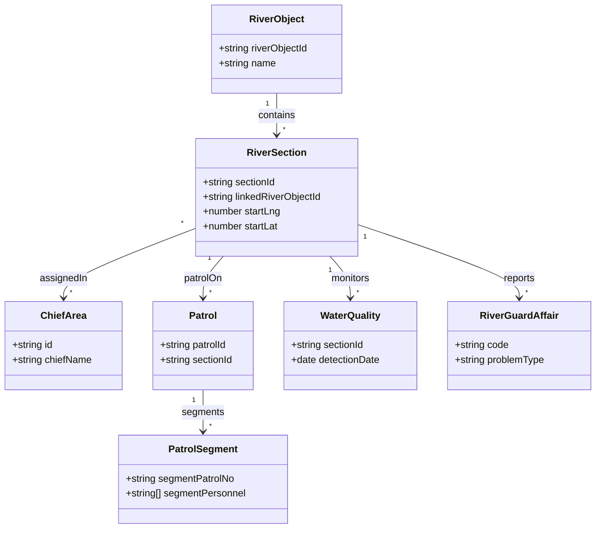
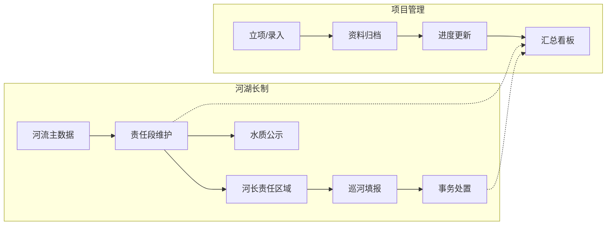
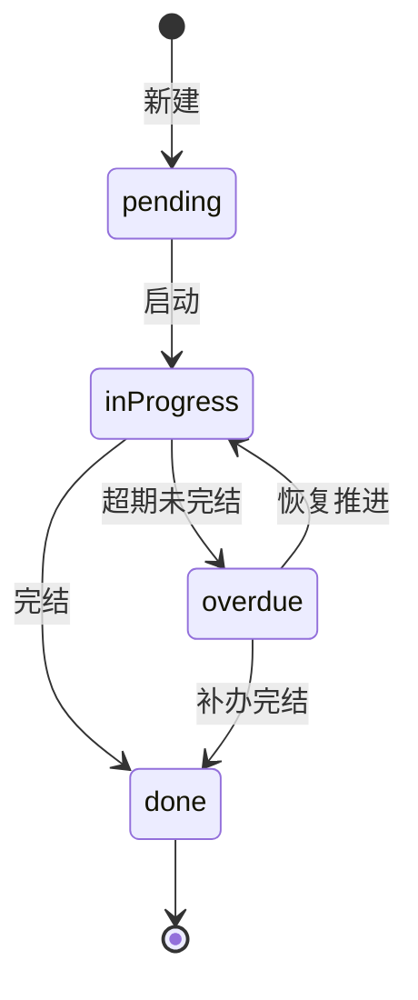

# 生态整治综合管理平台 — 产品需求文档（PRD）

## 0. 文档信息

| 项 | 内容 |
| --- | --- |
| 产品名称 | 生态整治综合管理平台 |
| 文档版本 | v1.1 |
| 状态 | Draft（与当前 Axhub 原型 `index.tsx`、`spec.md`、`riverChiefDb4401.ts` 对齐） |
| 目标上线（建议） | 以项目立项批复为准；原型阶段不绑定日期 |
| 负责人 | 产品负责人（填写） / 业务负责人（填写） |
| 适用范围 | **项目管理** + **河湖长制** 双模块；韶山水环境产品族子系统 |
| 关联文档 | `spec.md`（交互与视觉细则）、`PRD.md`（本文）、`riverChiefDb4401.ts`（演示数据与 DB4401 字段映射）、`style.css` |
| 关联系统 | **韶山水环境设施管理系统**（布局/组件同源）、**应急协同**（事务地图与表单对齐）、**综合态势**（统一点位检索消费本模块数据）、**韶山水环境系统管理**（配置中心扩展，后续） |
| 术语 | PRD = Product Requirements Document；**P0/P1/P2** 与 `spec.md` 功能优先级表一致；**原型** = Axhub 可交互演示，不等价于生产验收 |

---

## 1. 背景与目标

### 1.1 背景

水环境治理涉及**项目全生命周期档案**与**河湖长制责任体系**两类工作：前者强调投资、工期、参建方与资料沉淀；后者强调责任段、河长、巡河、水质公示与事务闭环。线下表格与分散系统导致检索慢、责任边界不清、跨部门协同成本高。地方标准 **DB4401/T 138—2021** 对河湖长制信息化字段有明确要求，系统建设需可映射到标准表语义，便于后续数据治理与上级汇交。

### 1.2 产品目标

1. **统一入口**：在同一平台内完成生态整治类项目的档案管理与河湖管护业务操作。  
2. **过程可追溯**：项目资料留痕；巡河、水质、事务处置可关联到责任段与河长；河长变更可审计。  
3. **决策可视化**：通过汇总统计、任务与履职评分等看板支撑例会调度与考核材料导出。  
4. **规范对齐**：河湖长制数据模型对齐 **DB4401/T 138—2021**（原型以 `riverChiefDb4401.ts` 为落地参考，对接阶段以主管部门数据字典为准）。  
5. **体验一致**：列表、弹窗、字段管理、操作列与「韶山水环境设施管理系统」同源，降低培训与误操作成本。

### 1.3 非目标（本期 / 原型阶段）

1. 不接真实后端与单点登录；权限模型为原型级示意。  
2. 文件上传为**前端元数据模拟**，不落对象存储；不对接电子签章。  
3. 责任段/事务等地图为**示意或 MapLibre 占位**，不以测绘级精度作为验收标准。  
4. 不对公众端「全民河长」App 做完整需求展开（可后续独立 PRD）。  
5. 本期不实现**跨市州数据交换**、**水利模型计算**、**无人机巡检自动入库**。

### 1.4 成功指标（正式系统建议，可纳入立项 KPI）

| 指标 | 定义 | 目标方向（示例） |
| --- | --- | --- |
| 项目档案完整率 | 必填字段 + 必备资料类型齐备的项目占比 | ≥ 95% |
| 责任段主数据覆盖率 | 已关联河流对象且坐标有效的责任段占比 | 100%（考核河段） |
| 巡河记录及时率 | 巡河结束后 T+1 日内入库占比 | ≥ 90% |
| 事务闭环率 | 已办结 / 已逾期跟踪的事务占比 | 按考核口径设定 |
| 统计导出使用率 | 月活跃业务用户中至少导出过一次统计的比例 | 用于验证看板价值 |

### 1.5 系统集成与依赖

| 集成对象 | 方向 | 说明 |
| --- | --- | --- |
| 综合态势 | 本模块 → 态势 | `initialRiverSectionData`、`initialRiverGuardAffairs` 等经 `zhtSearchUnifiedData` 聚合为地图/搜索统一点位 |
| 应急协同 | 双向对齐 | 事务列表地图选点、表单栅格与应急事件同源组件与样式常量 |
| 设施管理系统 | UI 基线 | 侧栏、面包屑、`detailModalStyles`、列表操作按钮语义色一致 |
| 系统管理 / 配置中心 | 后续 | 水利七类主数据、区划字典等以配置中心为权威源时可替换本地 `hydroInitial` 等演示数据 |

---

## 2. 用户角色

| 角色 | 核心诉求 | 典型场景 | 使用频率（预估） |
| --- | --- | --- | --- |
| 市级 / 县级管理员 | 掌握项目库与河湖台账、导出统计 | 项目汇总、任务完成统计、履职评分统计 | 高 |
| 河长办业务人员 | 维护责任段、责任区域、通讯录与事务 | 责任段信息、河长责任区域、事务列表 | 高 |
| 基层河长 / 巡河员 | 填报巡河记录、查看责任段与水质 | 巡河信息、水质监测公示 | 高 |
| 项目建设方（外协） | 被通知补录资料与进度 | 项目档案编辑（权限由正式系统控制） | 中 |
| 考核 / 督查人员 | 只读查阅与导出 | 水质公示、统计页 | 中 |
| 系统管理员 | 字典、组织、权限 | 对接配置中心后统一维护 | 低 |

---

## 3. 用户故事与验收标准

### 3.1 项目管理

#### US-P01 项目档案维护

**As a** 项目管理岗  
**I want to** 在「项目档案」中按条件查询并维护项目基本信息与项目资料  
**So that** 投资、工期、责任单位与资料清单可检索、可更新  

**验收标准**

1. Given 打开项目档案列表  
   When 输入项目名称、项目编号、类型、状态等条件并查询  
   Then 列表仅展示满足**全部已填条件（AND）**的记录。  

2. Given 点击「新增」或「编辑」  
   When 在「基本信息」「项目资料」页签中填写并保存  
   Then 资料列表支持增删；保存后列表与详情只读展示一致。  

3. Given 点击「详情」  
   When 打开只读弹窗  
   Then 展示与列表对齐的核心字段与项目资料清单；无底部主操作按钮；关闭方式符合 `spec.md`（右上角/遮罩/ESC）。

---

#### US-P02 项目汇总统计

**As a** 管理员  
**I want to** 按时间窗口与类型/地点筛选后查看指标卡与图表  
**So that** 例会材料可快速截图或导出  

**验收标准**

1. Given 切换「全部 / 本月 / 本季 / 本年 / 自定义」及项目类型、状态、建设地点  
   When 筛选生效  
   Then 指标卡、图表、汇总表与当前 `projectList` 子集一致。  

2. Given 点击导出（原型）  
   When 触发导出动作  
   Then 有明确成功或占位提示（不要求真实生成文件）。

---

#### US-P03 历史项目录入（P1）

**As a** 管理员  
**I want to** 补录已完工历史项目并标记归档  
**So that** 项目库时间维度完整  

**验收标准**

1. Given 项目状态为已完工  
   When 保存  
   Then 在汇总统计「完工率」口径中计入已完工集合（与 `spec.md` 统计规则一致）。

---

#### US-P04 项目成果展示（P1）

**As a** 管理员  
**I want to** 在地图或图表中对比治理前后  
**So that** 对外汇报有直观材料  

**验收标准**

1. Given 进入成果展示页（若实现）  
   When 选择某项目  
   Then 至少展示占位图表或说明文案；正式系统对接遥感/GIS 后替换数据源。

---

### 3.2 河湖长制

#### US-R01 责任段信息维护

**As a** 河长办业务人员  
**I want to** 维护责任段与河流对象、河段衔接及示意位置  
**So that** 下游巡河、水质、事务可关联到统一河段主数据  

**验收标准**

1. Given 新增或编辑责任段  
   When 未选择「所属河流（涌）对象」  
   Then 无法保存并提示必选。  

2. Given 选择河流对象  
   When 保存成功  
   Then 「所属水系」只读且与河流主数据一致；上一级河段下拉不含当前行。  

3. Given 打开详情  
   When 查看河段位置示意图  
   Then 展示起点—讫点示意（SVG），与 `spec.md` 描述一致。

---

#### US-R02 河长责任区域

**As a** 业务人员  
**I want to** 为河长配置责任区域名称、多选责任段及示意地图  
**So that** 巡河统计与通讯录可引用同一套责任范围  

**验收标准**

1. Given 在新增/编辑中选择多条责任段  
   When 在已选表格中移除某行  
   Then 示意地图与已选段列表同步更新。  

2. Given 打开详情且存在河长变更记录  
   Then `DetailTabsIfMultiple` 展示「基本信息」「关联河长变更记录」等 Tab 规则与 `spec.md` 一致。

---

#### US-R03 巡河信息

**As a** 巡河员  
**I want to** 登记巡河时间、人员、方式、轨迹摘要与问题  
**So that** 履职过程可查、可统计  

**验收标准**

1. Given 巡河台账含多段巡检记录  
   When 在列表查看「巡河时间」「巡河人员」  
   Then 展示聚合规则与 `spec.md` 一致（最早开始～最晚结束、人员去重合并）。  

2. Given 进入「巡河记录」子页  
   When 点击「编辑」补录段级记录并保存  
   Then 保存后恢复只读且列表摘要更新。  

3. Given 详情中「发现问题」子表  
   When 存在图片/视频  
   Then 支持预览交互与 `spec.md` 一致（`Image.PreviewGroup`、视频弹窗播放）。

---

#### US-R04 事务列表（上报事件）

**As a** 业务人员  
**I want to** 按规范字段登记河湖事务并处置闭环  
**So that** 与应急事件在地图与表单体验上对齐，便于培训  

**验收标准**

1. Given 保存新事务  
   When 系统生成编号  
   Then 符合 `HB-SW-年-流水号` 规则且编辑态只读展示说明。  

2. Given 编辑事务位置  
   When 在地图选点  
   Then 经纬度与位置描述写回表单；底图与应急协同同源常量（OpenFreeMap Liberty）。  

3. Given 打开详情  
   When 存在「基本信息 / 事务处置」  
   Then 使用 `DetailTabsIfMultiple`；字段顺序与 `spec.md`、应急事件编辑对齐。

---

#### US-R05 水质监测公示

**As a** 公众或业务人员  
**I want to** 按区域、责任段、时间、监测点查询水质记录  
**So that** 公示信息与责任段绑定清晰  

**验收标准**

1. Given 打开水质监测公示页  
   When 查看表头  
   Then 含责任段名称列且**不出现「断面」**字样。  

2. Given 工具栏  
   Then **仅有导出（原型示意）**，无导入按钮。  

3. Given 点击行「详情」  
   Then 展示完整监测记录只读信息。

---

#### US-R06 河道水体 — 河流 / 湖泊信息（P1）

**As a** 业务人员  
**I want to** 维护河流主数据与湖泊信息及与责任段的关联  
**So that** 责任段下拉与统计口径一致  

**验收标准**

1. Given 打开河流信息详情  
   When 存在多条关联责任段  
   Then 「关联河段」表列出 `linkedRiverObjectId` 一致的全部责任段；代表河段标签规则与 `spec.md` 一致。

---

#### US-R07 任务完成情况与统计

**As a** 管理员  
**I want to** 维护专项任务并在统计页按期限与类型分析完成率与逾期率  
**So that** 专项调度有依据  

**验收标准**

1. Given 任务台账与统计页  
   Then 二者共享同一 `taskList` 数据源。  

2. Given 筛选完成期限时间窗口与任务类型、状态  
   Then 指标卡与图表、汇总表与筛选子集一致。

---

#### US-R08 履职综合评分与统计

**As a** 考核人员  
**I want to** 录入四维成绩与权重并查看综合分与排名  
**So that** 河长履职可量化  

**验收标准**

1. Given 维护权重  
   When 权重之和不为 100  
   Then 保存失败并提示。  

2. Given 打开评分详情  
   When 台账或权重变更后再次打开  
   Then 展示与列表一致（避免快照陈旧，规则见 `spec.md`）。  

3. Given 履职综合评分统计页  
   When 开启「纵向对比」  
   Then 展示与相邻上一周期对比或「—」占位。

---

#### US-R09 河长通讯录

**As a** 业务人员  
**I want to** 维护河长人员与区划、河段关联  
**So that** 责任段、责任区域、评分等下拉数据源一致  

**验收标准**

1. Given 修改通讯录中某河长记录  
   When 返回责任段或责任区域编辑页  
   Then 河长下拉选项已反映最新数据（主入口共享状态）。

---

#### US-R10 河长变更记录（P2）

**As a** 管理员  
**I want to** 记录河长变更全过程  
**So that** 责任交接可追溯  

**验收标准**

1. Given 新增变更记录并选择新河长自通讯录  
   Then 责任区域详情「关联河长变更记录」列表可见新记录。

---

#### US-R11 巡河数据统计

**As a** 管理员  
**I want to** 按时间、河长级别、责任区域筛选巡河指标  
**So that** 与巡河信息列表数据同源可解释  

**验收标准**

1. Given 筛选条件变更  
   When 渲染统计卡片与分级报表  
   Then 数据与 `patrolList` 过滤结果一致。

---

## 4. MVP 范围（Story Mapping）

| 优先级 | 模块 | 用户故事 / 能力 | 本期 |
| --- | --- | --- | --- |
| Must | 项目管理 | US-P01 项目档案、档案查询、信息展示 | 是 |
| Must | 项目管理 | 新增/编辑/详情弹窗（基本信息 + 项目资料） | 是 |
| Should | 项目管理 | US-P02 项目汇总统计 | 是 |
| Could | 项目管理 | US-P03、US-P04 | 原型占位 / P1 |
| Must | 河湖长制 | US-R01～R05 | 是 |
| Should | 河湖长制 | US-R06、US-R07、US-R08、US-R09、US-R11 | 是 |
| Could | 河湖长制 | US-R10 | P2 |

---

## 5. 领域模型与流程

### 5.1 核心实体与关键字段

| 实体 | 关键字段（摘要） | 说明 |
| --- | --- | --- |
| 项目 | 编号、名称、类型、地点、工期、投资、状态、进度、责任单位、施工单位、监理、目标、描述 | `projectList` |
| 河流对象 | `riverObjectId`、水系、代表河段 | 河道水体主数据 |
| 责任段 | `SECTION_ID` 语义、`linkedRiverObjectId`、起讫经纬、河长姓名、管理级别、一河一档自然属性 | `riverSectionList` |
| 河长责任区域 | 区域名称、河长、多责任段、示意、管护重点 | 与通讯录、变更记录关联 |
| 巡河台账 | 台账头 + `segments[]`（人员、时段、距离、轨迹摘要等） | `patrolList` |
| 水质记录 | 责任段、区域、时间、五参数、水质类别 | 公示列表 |
| 事务 | 编号、问题类型、严重程度、位置、处置、状态 | `RiverGuardAffairRow` |
| 任务 | 名称、类型、责任单位、期限、进度、状态 | `taskList` |
| 履职评分 | 周期、河长、四维成绩、权重、综合分、等级 | `eco-manual-chief-evaluations-v1` 等 |
| 通讯录 | 用户编号、河长级别、责任区域、区划、手机 | `riverChiefContacts` |

### 5.2 领域关系（类图示意）

### 5.3 主业务流程

### 5.4 状态机（摘要）

**项目状态（示例）**：规划中 → 实施中 → 已完工 → 已归档（具体枚举以业务字典为准）。  

**任务状态**（与 `spec.md` 一致）：待启动 → 进行中 → 已完成 / 已逾期。  

### 5.5 权限矩阵（正式系统建议）

| 操作 | 管理员 | 河长办 | 河长/巡河员 | 只读 |
| --- | --- | --- | --- | --- |
| 项目档案增删改 | ✓ | 按组织 | 否 | 视范围 |
| 责任段/责任区域维护 | ✓ | ✓ | 否 | 否 |
| 巡河登记 | ✓ | ✓ | ✓（本人/本段范围） | 否 |
| 事务处置 | ✓ | ✓ | 部分字段 | 否 |
| 履职评分录入 | ✓ | ✓ | 否 | 否 |
| 统计与导出 | ✓ | ✓ | 仅本人相关 | ✓ |
| 通讯录维护 | ✓ | ✓ | 否 | 否 |

（原型阶段全部为可编辑演示数据。）

### 5.6 页面结构模型

| 一级分组 | 页面 / 子页 | 主内容 | 关键 extra / 工具栏 |
| --- | --- | --- | --- |
| 项目管理 | 项目档案 | Table + 筛选 + 分页 | 导出、导入、字段、新增 |
| 项目管理 | 项目汇总统计 | 指标卡 + ECharts + 汇总表 | 导出（示意） |
| 河湖长制 | 责任段信息 | Table + 表单/详情 | 同左 |
| 河湖长制 | 河道水体 / 河流信息、湖泊信息 | 主从、详情 Tab | 关联河段表 |
| 河湖长制 | 河长责任区域 | 多选责任段 + 示意地图 | 变更 Tab |
| 河湖长制 | 巡河信息 | 列表 + 详情多 Tab | 巡河记录子页入口 |
| 河湖长制 | 巡河数据统计 | 筛选 + 指标 + 分级报表 | 导出 |
| 河湖长制 | 任务完成情况 / 任务完成统计 | 列表 / 看板 | 与任务台账共享 |
| 河湖长制 | 履职综合评分 / 统计 | 表单 + 雷达 + 排名 | 权重校验 |
| 河湖长制 | 水质监测公示 | 列表 + 详情 | 仅导出 |
| 河湖长制 | 事务列表 | 列表 + 地图选点编辑 | 处置填报 |
| 河湖长制 | 河长通讯录 | 列表 + 表单 | 导出、导入、字段 |
| 河湖长制 | 河长变更记录 | 列表 | 导出、导入、字段 |

### 5.7 数据血缘（统计类页面）

| 消费方 | 数据源 | 说明 |
| --- | --- | --- |
| 项目汇总统计 | `projectList` | 与项目档案共享 |
| 巡河数据统计 | `patrolList` | 与巡河信息共享 |
| 任务完成统计 | `taskList` | 与任务完成情况共享 |
| 履职综合评分统计 | 评分台账 + 当前权重配置 | 每渲染读取权重，与评分页一致 |
| 综合态势地图搜索 | `initialRiverSectionData`、`initialRiverGuardAffairs` 等 | 经统一检索模块投影 |

### 5.8 信息架构（目录树）

与 `spec.md` §2.1 一致：**项目管理**（项目档案、汇总统计等）+ **河湖长制**（责任段、河道水体、河长责任区域、巡河、巡河统计、任务、任务统计、履职评分、履职统计、水质公示、事务、通讯录、变更记录）。

---

## 6. 非功能需求

| 类别 | 要求 |
| --- | --- |
| 易用性 | 列表筛选、字段管理、操作列（详情/编辑）、删除仅在编辑弹窗等与设施管理同源；核心列表查询路径 ≤ 3 步（打开页 → 填条件 → 查询）。 |
| 一致性 | 视觉变量与 `#1e5bb5` 主色体系统一；弹窗宽度、详情 `Descriptions` 规则与设施管理/应急对齐。 |
| 可扩展性 | 事务、巡河、责任段字段预留与应急、综合态势检索对齐；字典键与 DB4401 扩展字段可配置化（正式）。 |
| 性能（正式） | 列表分页查询 P95 &lt; 500ms；大表导出走异步任务；统计预聚合可选。 |
| 可靠性（正式） | 关键写操作幂等、乐观锁版本号；导出任务可重试。 |
| 安全（正式） | RBAC、操作审计、附件病毒扫描、敏感字段脱敏、HTTPS；本期原型不验收。 |
| 可观测性（正式） | 埋点见 §9；接口错误率与慢查询监控。 |

---

## 7. 验收清单（Definition of Done）

- [ ] §3 所列 **Must / Should** 用户故事验收标准在原型可演示路径上全部满足。  
- [ ] `spec.md` 中 **P0** 功能：列表 + 筛选 + 分页（或等价说明）齐全。  
- [ ] 事务编号、责任段与河流外键、巡河多段聚合、任务与统计同源、评分权重之和等**业务规则**与 `spec.md` 无冲突。  
- [ ] 侧栏 IA、面包屑、删除位置、`DetailTabsIfMultiple` 行为与设施管理/应急一致且无回归。  
- [ ] 与综合态势、应急协同的**数据字段命名**在对接文档中单列对齐表（可另附《数据映射》）。  
- [ ] 产品、业务、研发对本文 **v1.1** 评审签字或邮件确认（可选）。

---

## 8. 术语表

| 术语 | 解释 |
| --- | --- |
| 责任段 | 河湖管理最小河段单元，含起讫与归属河流对象 |
| 代表河段 | 河流主数据上用于展示或统计的代表性责任段 |
| 一河一档 | 河流（段）自然属性集合，原型合并于责任段记录 |
| 巡河台账头 / 巡检段 | 一次巡河登记头信息与多段现场巡检明细 |
| 事务 / 上报事件 | 河湖管护问题上报与处置闭环，字段扩展参考 DB4401 |
| 信息点蓝 | 综合态势地图统一点位展示语义，见态势 PRD/规格 |

---

## 9. 风险与依赖

| 风险 | 影响 | 缓解 |
| --- | --- | --- |
| 地方标准与省平台字段差异 | 对接返工 | 尽早锁定《数据映射》与主管部门字典 |
| 地图与测量坐标系不一致 | 位置偏移 | 统一 CGCS2000/WGS84 及转换服务 |
| 大附件与视频 | 性能与合规 | 分对象存储、CDN、转码与保留期策略 |
| 多部门维护同一河长 | 数据冲突 | 主数据归口 + 变更审批流 |

---

## 10. 埋点与运营指标（正式建议）

| 事件 | 属性 | 用途 |
| --- | --- | --- |
| `eco_project_list_query` | 筛选条件 hash、结果条数 | 优化默认筛选 |
| `eco_affair_save` | 是否含地图选点、耗时 | 地图性能 |
| `eco_patrol_segment_save` | 段数、是否带轨迹 | 巡河深度 |
| `eco_export_click` | 模块、格式 | 导出需求优先级 |

---

## 11. 接口与数据对接清单（占位，正式填写）

| 序号 | 接口说明 | 方法 | 路径/主题（占位） | 提供方 | 优先级 |
| --- | --- | --- | --- | --- | --- |
| 1 | 分页查询项目档案 | GET | `/api/eco/projects` | 业务后端 | P0 |
| 2 | 保存责任段 | PUT | `/api/eco/sections/{id}` | 业务后端 | P0 |
| 3 | 同步河长通讯录 | GET/POST | `/api/eco/chief-contacts` | 主数据 | P0 |
| 4 | 上传项目资料 | POST | `/api/eco/projects/{id}/files` | 文件服务 | P1 |
| 5 | 上级平台汇交 | 批量任务 | `/jobs/submit` | 数据交换 | P1 |

---

## 12. 修订记录

| 版本 | 日期 | 说明 |
| --- | --- | --- |
| v1.0 | 2026-04-22 | 首版：从 `spec.md` 抽象 PRD 结构 |
| v1.1 | 2026-04-22 | 补充：成功指标、集成边界、扩展用户故事、类图/流程/状态机、页面与数据血缘、术语、风险、埋点与接口占位、DoD 强化 |
